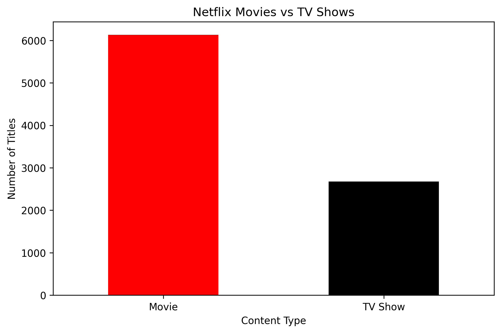
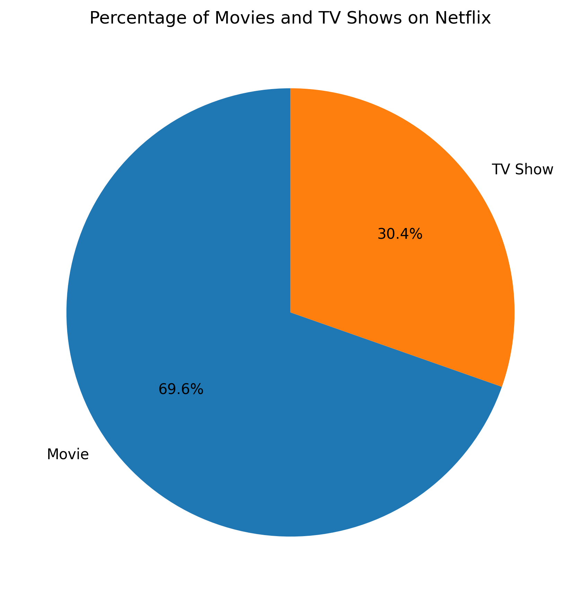
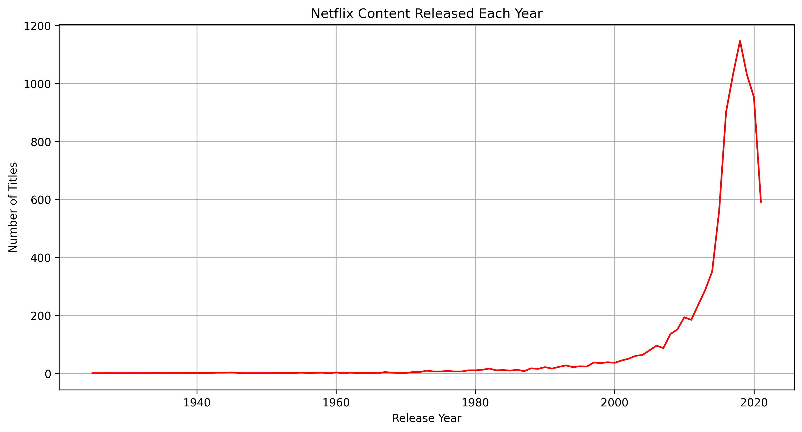
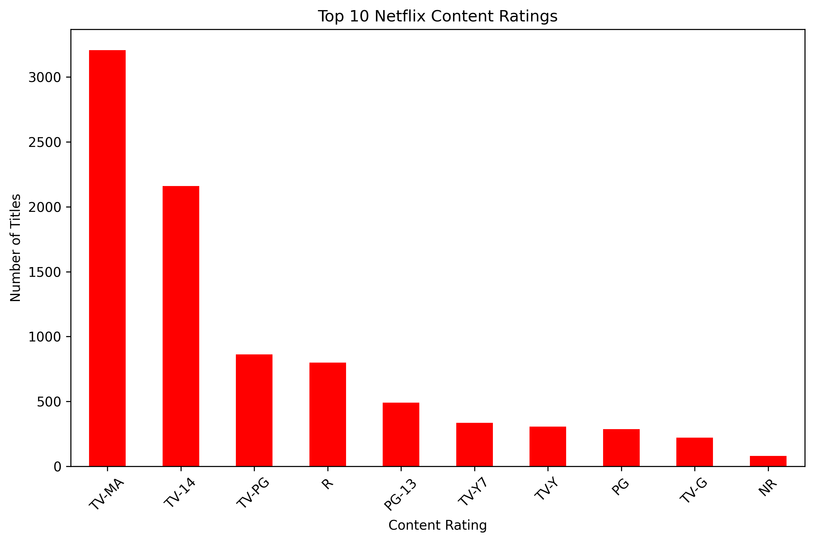
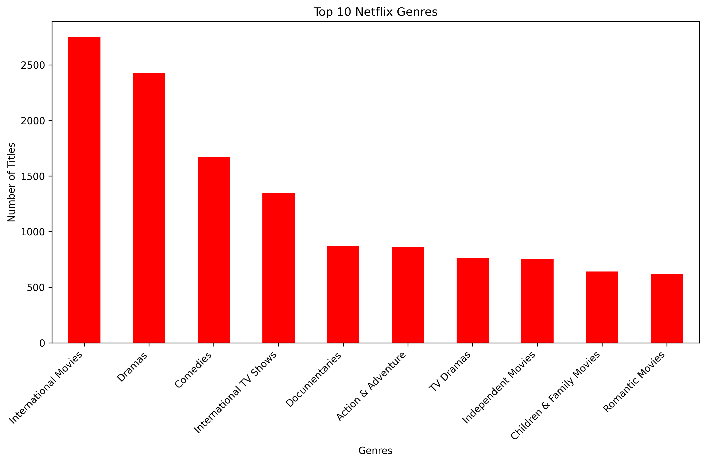

# Netflix Data Analysis using Python

## Project Overview
This project explores the Netflix Movies and TV Shows dataset using Python. The main objective is to understand Netflix content through data cleaning, analysis, and visualization.

## Tools and Technologies
- Python
- Google Colab
- Pandas
- Matplotlib
- Data Visualization

## Dataset
Netflix Movies and TV Shows dataset from Kaggle.

## Data Cleaning
- Checked missing values.
- Checked duplicate records.
- Handled missing values in the duration column.

## Exploratory Data Analysis
The following analyses were performed:

1. Movies vs TV Shows
2. Percentage of Movies and TV Shows
3. Top 10 Countries with Most Netflix Titles
4. Netflix Content Released Each Year
5. Top 10 Netflix Content Ratings
6. Top 10 Netflix Genres

## Visualizations

### 1. Movies vs TV Shows

### 2. Content Percentage

### 3. Top 10 Countries

### 4. Netflix Release Year

### 5. Netflix Content Ratings

### 6. Top 10 Genres

## Conclusion
This project helped explore Netflix content distribution across movies, TV shows, countries, release years, ratings, and genres using Python data analysis and visualization.
